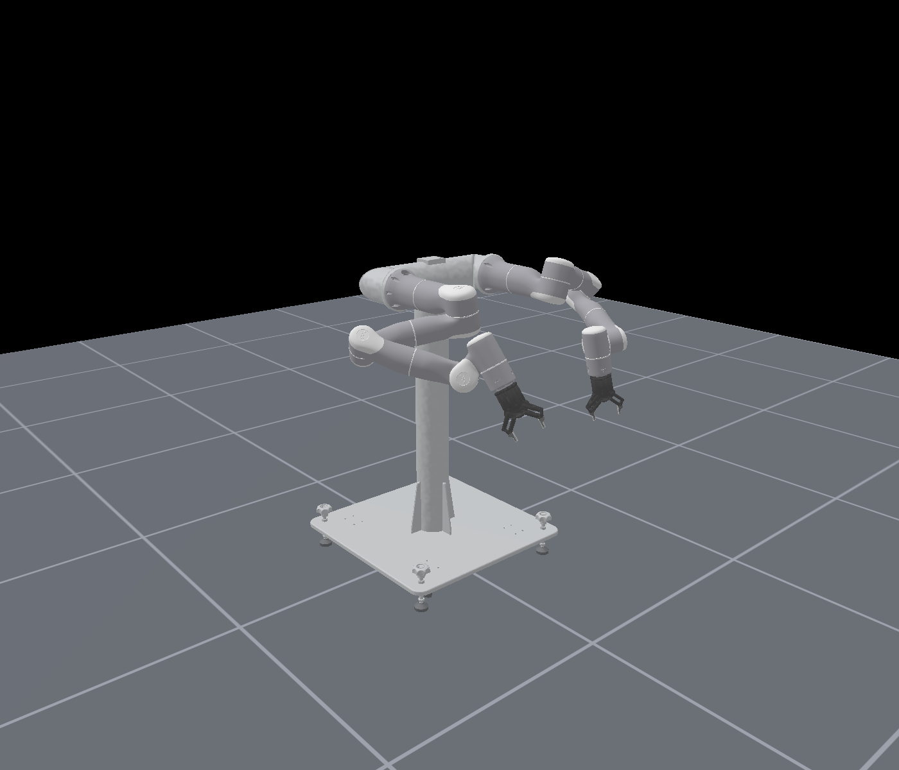

# Flexiv Teleop Sim

基于本仓库的 ManiSkill / SAPIEN 仿真，用 UArm 控制 Flexiv Rizon4，
并提供两台 Rizon4 安装在立柱底座上的双臂仿真场景。机械臂均配备
Flexiv Grav（Flexiv-GN01）夹爪。



## 当前功能

| 功能 | 入口 | 是否需要 UArm |
| --- | --- | --- |
| 单臂 Rizon4 + Grav 模型查看 | `static_robot_viewer.py` | 否 |
| UArm → 单臂 Rizon4 串口遥操作 | `teleop_sim.py` | 是，8 个舵机通道 |
| 双臂 Rizon4 + Grav + STEP 立柱底座 | `dual_flexiv_viewer.py` | 否 |
| 双臂独立关节、末端位姿和夹爪控制接口 | `FlexivDualArm-v1` | 否，可通过 Python 控制 |
| 无窗口 CPU 物理运行 | `dual_flexiv_viewer.py --headless` | 否 |

**双臂装配和控制接口已实现，双 UArm 串口遥操作尚未接入。**
`teleop_sim.py` 当前控制一台仿真机械臂；`dual_flexiv_viewer.py` 展示双臂并保持初始姿态。
这些入口不连接真实 Flexiv 机械臂，也不调用 Flexiv RDK。

## 环境准备

当前已验证环境为 Ubuntu、Python 3.10、PyTorch 2.8.0、SAPIEN 3.0.1、
Gymnasium 0.29.1、PySerial 3.5。沿用已有的 `uarm` 环境即可：

```bash
conda activate uarm
# 从仓库根目录进入仿真目录
cd src/simulation
```

后文的启动命令均在 `src/simulation` 中执行，使 Python 优先加载仓库内
包含 Flexiv 适配的 `mani_skill`。只安装 PyPI 上的 ManiSkill 不会包含本仓库的新增模型和场景。

已有环境能运行时，无需重新安装依赖。新环境的完整依赖清单见
[requirements.txt](requirements.txt)，从仓库根目录安装：

```bash
python -m pip install -r requirements.txt
```

窗口显示、离屏渲染图片都需要可用的 Vulkan/GPU；纯 CPU 无窗口物理运行不需要渲染器。
运行现有模型不需要 ROS、Flexiv RDK、CAD 软件，也不需要重新下载模型。

## 快速开始

### 查看单臂

```bash
python static_robot_viewer.py --robot flexiv_rizon4 --pose home
```

### 用 UArm 遥操作单臂

连接 Zhonglin 串口版 UArm，确认端口后运行：

```bash
python teleop_sim.py --robot flexiv_rizon4 --scene Empty-v1 --serial-port /dev/ttyUSB0
```

1. 等待仿真窗口打开，此时机械臂保持初始姿态，不会跟随 UArm。
2. 将 UArm 调整到合适的参考姿态，松开夹爪扳机并保持不动。
3. 切回**启动程序的终端**，按 **Enter** 完成标定并开始跟随。
4. 按扳机切换夹爪开合。输入 `q` 后回车，或按 Ctrl+C 退出。

标定读取失败时不会开始跟随，可按 Enter 重试。完成标定后，再按 Enter 不会重新选取零位；
需要重新标定时退出并重启程序。

| UArm 舵机 ID | 仿真动作 |
| --- | --- |
| `000` | `joint1` |
| `001` | `joint2`，角度偏移反向 |
| `002–006` | `joint3–joint7`，按顺序对应 |
| `007` | Grav 夹爪开合切换 |

机械臂使用相对映射：

```text
仿真目标角度 = 仿真初始角度 + 方向 ×（UArm 当前角度 − 手动标定角度）
方向 = [1, -1, 1, 1, 1, 1, 1]
```

计算后的目标角度受 Rizon4 关节限位约束。扳机相对标定位置转到 **−40° 或以下**时切换一次开合，
松回 **−30° 或以上**后可再次触发。夹爪初始张开，按住不重复触发，松开保持当前状态。

### 用两个 UArm 遥操作双臂

```bash
python dual_teleop_sim.py --left-port /dev/ttyUSB0 --right-port /dev/ttyUSB1
```

标定方式与单臂相同：两台 UArm 都保持静止后按 Enter。

### 查看双臂装配

```bash
python dual_flexiv_viewer.py
```

使用提供的 `非夕双臂立柱机械臂底座-20260523.stp` 转换后的底座网格：

- 左右按**机器人自身视角**定义，正面观察时与画面左右相反。
- 左臂航插朝下，右臂航插朝上；安装盘中心间距为 **500 mm**。
- 保留两侧 Grav 夹爪、两臂之间及机械臂与底座之间的碰撞。
- 初始关节姿态参照 `reference.jpg` 调整；这是单张照片的近似复现，不是实机测量角度。
- 底座固定在世界坐标中，脚轮为静态几何。

无窗口运行或保存预览：

```bash
# 纯 CPU 物理运行，不打开窗口
python dual_flexiv_viewer.py --headless --duration 2

# 离屏渲染，需要 Vulkan/GPU
python dual_flexiv_viewer.py --headless --duration 1 --output /tmp/dual_flexiv.png
```

## 双臂配置与控制

环境 ID 为 `FlexivDualArm-v1`，两个独立控制条目分别为：

| 机械臂 | 动作字典键 | 基座位置 / m | 航插方向 |
| --- | --- | --- | --- |
| 左臂 | `flexiv_rizon4-0` | `(0.115, 0.250, 1.305)` | 向下 |
| 右臂 | `flexiv_rizon4-1` | `(0.115, -0.250, 1.305)` | 向上 |

在 `pd_joint_pos` 模式下，每臂动作是 **7 个绝对关节角（弧度）+ 1 个夹爪指令**。
夹爪指令 `+1` 为张开、`-1` 为闭合。两臂动作通过字典传入，不是拼接为一个 16 维数组。

固定安装与初始关节姿态都记录在
[assembly.json](src/simulation/mani_skill/assets/scenes/flexiv_dual_arm/assembly.json)：

| 字段 | 作用 |
| --- | --- |
| `mounts.left/right.position` | 基座安装位置，单位米 |
| `mounts.left/right.quaternion_wxyz` | 基座安装旋转，顺序为 `w, x, y, z` |
| `mounts.left/right.arm_qpos` | 初始七轴关节角，单位弧度 |

只想调整摆臂和腕部姿态时，修改 `arm_qpos`，重启后生效。
安装坐标、完整 Python 控制示例和 CAD 转换说明见[双臂装配文档](src/simulation/DUAL_FLEXIV.md)。

## 验证

无需连接 UArm、无需打开窗口：

```bash
python -m unittest test_dual_flexiv test_flexiv_rizon4 test_dual_teleop_sim test_teleop_sim
```

覆盖安装方向、关节限位、双臂独立控制、夹爪联动与接触释放、手动标定和扳机切换。
串口硬件与交互窗口仍需在实际设备上验证。

## 文档与代码入口

| 内容 | 路径 |
| --- | --- |
| 仿真运行、API 与常见问题 | [src/simulation/README.md](src/simulation/README.md) |
| 双臂坐标、准备姿态与控制示例 | [src/simulation/DUAL_FLEXIV.md](src/simulation/DUAL_FLEXIV.md) |
| UArm 串口读取、手动标定、动作映射 | [teleop_sim.py](src/simulation/teleop_sim.py) |
| 双臂查看器 | [dual_flexiv_viewer.py](src/simulation/dual_flexiv_viewer.py) |
| 双臂环境 | [flexiv_dual_arm.py](src/simulation/mani_skill/envs/tasks/flexiv_dual_arm.py) |
| Rizon4 与 Grav 控制器 | [flexiv_rizon4.py](src/simulation/mani_skill/agents/robots/flexiv_rizon4/flexiv_rizon4.py) |
| 机械臂模型来源与再生成 | [模型说明](src/simulation/mani_skill/assets/robots/flexiv_rizon4/README.md) |

Flexiv 模型来自 [Flexiv 官方 flexiv_description](https://github.com/flexivrobotics/flexiv_description)，
其许可证与上游版本记录保存在模型目录。项目许可证见 [LICENSE.txt](LICENSE.txt)。
