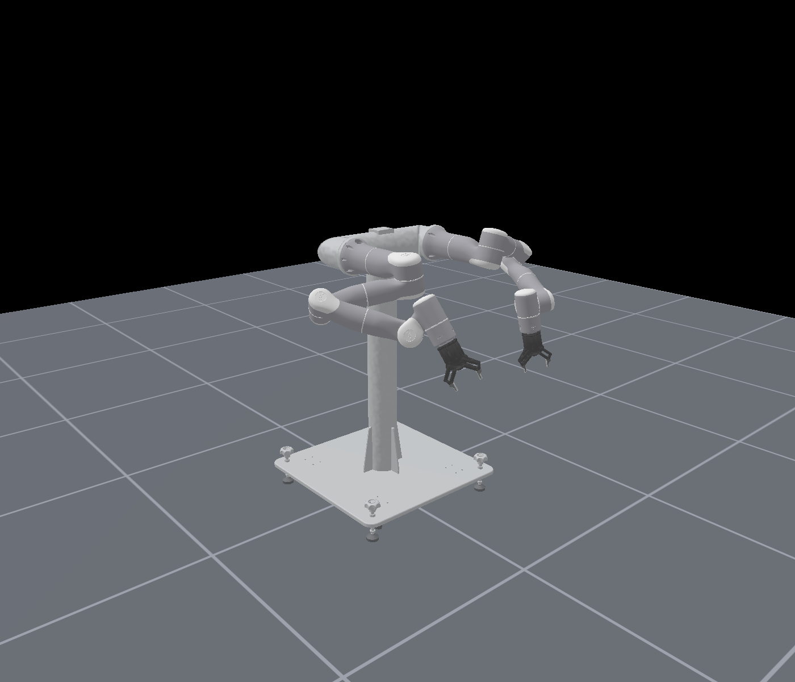

# Flexiv 仿真与 UArm 遥操作

本目录提供 Rizon4 + Grav 单臂仿真、UArm 串口遥操作，以及安装在 STEP
立柱底座上的双臂场景。首次使用先看[根目录快速开始](../../README.md)。
双臂的坐标、默认姿态和网格再生成见 [DUAL_FLEXIV.md](DUAL_FLEXIV.md)。



## 运行目录与环境

以下命令均从本目录执行：

```bash
# 从仓库根目录执行
conda activate uarm
cd src/simulation
```

`uarm` 是当前已有环境的名称；使用其他环境时，激活自己的环境即可。
参考环境为 Python 3.10、PyTorch 2.8.0、SAPIEN 3.0.1、Gymnasium 0.29.1、
PySerial 3.5。完整依赖见根目录 [requirements.txt](../../requirements.txt)。

本仓库内的 `mani_skill` 包含新增的机器人注册、控制器和场景，运行时应加载本地代码：

```bash
python -c "import mani_skill; print(mani_skill.__file__)"
```

输出应指向本仓库的 `src/simulation/mani_skill/__init__.py`。
若指向 `site-packages`，先检查当前目录和解释器。

| 运行方式 | 串口硬件 | Vulkan/GPU |
| --- | --- | --- |
| 单臂静态查看 | 不需要 | 需要 |
| 单臂 UArm 遥操作 | 需要 8 通道 UArm | 需要 |
| 双臂窗口查看 | 不需要 | 需要 |
| 双臂 `--headless`，不加 `--output` | 不需要 | 不需要 |
| 双臂 `--headless --output …` | 不需要 | 需要 |
| 下文的 CPU 单元测试 | 不需要 | 不需要 |

这些脚本直接使用 Python 和串口，不需要启动 ROS。现有机器人和底座网格已随代码保存，
运行时不需要 xacro、gmsh、原始 STP 或 Flexiv RDK。

## 单臂查看

```bash
python static_robot_viewer.py --robot flexiv_rizon4 --pose home
# 指定运行时长
python static_robot_viewer.py --robot flexiv_rizon4 --pose home --duration 10
```

| 参数 | 默认值 | 说明 |
| --- | --- | --- |
| `--robot` / `-r` | `so100` | 使用 Flexiv 时显式传 `flexiv_rizon4` |
| `--scene` / `-s` | `Empty-v1` | 场景 ID |
| `--pose` / `-p` | `default` | Flexiv 使用 `default` 或 `home` |
| `--duration` / `-d` | 不限时 | 运行秒数；也可 Ctrl+C 退出 |

当前 Flexiv 单臂的 rest/home 都使用官方初始关节姿态，Grav 初始张开。
静态查看器用于显示姿态，不读取 UArm，也不执行持续物理运动。

## UArm → 单臂 Rizon4

### 启动与手动标定

```bash
python teleop_sim.py --robot flexiv_rizon4 --scene Empty-v1 --serial-port /dev/ttyUSB0
```

按以下顺序操作：

1. 程序打开串口、发送舵机初始化/解锁命令，并启动仿真。
2. 等待阶段只刷新窗口，不施加遥操作动作或推进物理步。
3. 将 UArm 摆到舒服、便于继续移动的参考姿态，松开扳机并保持不动。
4. 在**启动程序的终端按 Enter**，采集全部 8 个通道的参考角度。
5. 看到 `Calibration complete; teleoperation active` 后开始跟随。

标定必须完整读取所有通道；任一通道失败都不会提交零位或开始跟随。
按 Enter 可以重试。已经标定后再按 Enter 保留现有零位，重新标定需重启程序。
输入 `q` 后回车或按 Ctrl+C 退出。终端输入关闭时程序也会退出，因此需要交互式终端。

| 参数 | 默认值 | 说明 |
| --- | --- | --- |
| `--robot` / `-r` | `so100` | Flexiv 为 `flexiv_rizon4` |
| `--scene` / `-s` | `ReplicaCAD_SceneManipulation-v1` | 首次使用建议显式指定 `Empty-v1` |
| `--serial-port` | `/dev/ttyUSB0` | Zhonglin 串口设备，代码波特率为 115200 |
| `--rate` | `50.0` | 目标循环频率，单位 Hz；实际速度受串口往返和渲染耗时限制 |

### 关节映射

Rizon4 使用 **7 个机械臂通道 + 1 个独立夹爪通道**，不复用第七轴控制夹爪。

| 舵机 ID | 仿真关节 | 偏移方向 |
| --- | --- | --- |
| `000` | `joint1` | 正向 |
| `001` | `joint2` | 反向 |
| `002` | `joint3` | 正向 |
| `003` | `joint4` | 正向 |
| `004` | `joint5` | 正向 |
| `005` | `joint6` | 正向 |
| `006` | `joint7` | 正向 |
| `007` | Grav 扳机开合切换 | 见下文 |

映射在 `teleop_sim.py` 的 `convert_pose_to_action` 中：

```text
UArm 偏移 = 当前角度 − 手动标定角度
仿真目标 = 仿真初始关节角 + [1, -1, 1, 1, 1, 1, 1] × UArm 偏移
```

机械臂目标角度使用弧度，并裁剪到 URDF 关节范围。
因此 UArm 与仿真臂不必具有相同的启动零位；标定姿态对应仿真初始姿态。
这属于关节空间相对映射，并未实现 UArm 末端位姿到 Rizon4 的笛卡尔空间映射。

### Grav 扳机逻辑

| 操作 | 结果 |
| --- | --- |
| 标定完成 | 夹爪保持初始张开 |
| 相对标定角度达到 `≤ −40°` | 切换一次张开/闭合 |
| 持续按住 | 不重复触发 |
| 松回 `≥ −30°` | 允许下一次按压触发，夹爪状态保持 |
| 再次按到 `≤ −40°` | 再次切换开合 |

阈值位于 `teleop_sim.py` 的 `TRIGGER_PRESS_ANGLE` 和 `TRIGGER_RELEASE_ANGLE`。
当前遥操作发送全开/全闭指令，不按扳机深度连续调节开口。
标定时应松开扳机，因为阈值相对于标定角度计算。

### 在 ReplicaCAD 中运行

已有场景资源时可使用：

```bash
python replicacad_robot_viewer.py --robot flexiv_rizon4
python teleop_sim.py --robot flexiv_rizon4 --scene ReplicaCAD_SceneManipulation-v1 --serial-port /dev/ttyUSB0
```

ReplicaCAD 数据独立于仓库内机器人网格。缺少场景资源时先使用 `Empty-v1`，
不要把场景资源缺失当作 Rizon4 模型加载失败。

## 双臂装配

```bash
python dual_flexiv_viewer.py
python dual_flexiv_viewer.py --duration 10
python dual_flexiv_viewer.py --headless --duration 2
python dual_flexiv_viewer.py --headless --duration 1 --output /tmp/dual_flexiv.png
```

| 参数 | 默认值 | 说明 |
| --- | --- | --- |
| `--duration` | 窗口不限时 | 运行秒数；无窗口且未指定时为 2 秒 |
| `--headless` | 关闭 | 不打开窗口；不保存图片时关闭渲染器 |
| `--output` | 不保存 | 输出 PNG 路径；即使无窗口也需要 Vulkan/GPU |

环境 ID 为 `FlexivDualArm-v1`。模型为两台 Rizon4 + Grav 和由提供的 STEP 文件
转换的立柱底座。左右均按机器人自身视角定义：**左臂航插向下，右臂向上**。
两个安装盘相距 500 mm，世界坐标 `+X` 向前、`+Y` 向左、`+Z` 向上。

默认准备姿态参照 `reference.jpg` 调整，右腕单独匹配照片的侧倾、关节盖和夹指方向。
单张照片无法唯一还原实机关节角，当前配置是可见构型的近似复现。

原始 STP、参考照片和包含原图的腕部对照图片不随仓库发布；
仓库保留运行必需的转换网格和纯仿真预览。

`dual_flexiv_viewer.py` 持续发送保持姿态的动作，不读取串口；
双 UArm 的左右串口、标定与动作路由尚未实现。

### 修改初始姿态

编辑 [assembly.json](mani_skill/assets/scenes/flexiv_dual_arm/assembly.json) 中的
`mounts.left.arm_qpos` 或 `mounts.right.arm_qpos`，按 `joint1–joint7` 填入 **7 个弧度值**，
重启查看器后生效。角度转换示例：

```python
import numpy as np
print(np.deg2rad([0, 30, 0, 90, 0, 45, 0]).tolist())
```

`position` 是安装位置，`quaternion_wxyz` 是安装旋转。
只调整机械臂关节姿态时保留这两个字段，以免改变安装面或航插方向。
重新运行底座转换脚本会恢复脚本中保存的默认姿态，自定义姿态应另行保留。

## Python 控制接口

机器人 ID 为 `flexiv_rizon4`，末端参考坐标系为 `grav_tcp`，距夹爪基座 150 mm。
单臂有 14 个活动关节：7 个机械臂关节、6 个夹爪连杆关节和 1 个虚拟宽度关节。
夹爪由 mimic 控制器统一驱动，所以动作维度小于活动关节数。

| 控制模式 | 每臂动作 | 机械臂部分 | 最后一个分量 |
| --- | --- | --- | --- |
| `pd_joint_pos` | 8 维 | 7 个绝对关节角，弧度 | 夹爪 `[-1, 1]` |
| `pd_joint_delta_pos` | 8 维 | 7 个归一化增量，映射到每步 `[-0.1, 0.1]` rad | 夹爪 `[-1, 1]` |
| `pd_ee_delta_pose` | 7 维 | 归一化的 3 维平移 + 3 维旋转增量 | 夹爪 `[-1, 1]` |

夹爪 `-1` 闭合、`+1` 张开；中间值可用于目标开口控制。
内部虚拟宽度值范围为 `[0, 0.1]`，用于生成连杆角度，不应当作实测指间距离。
控制器的增益和力矩限幅是仿真设置，不代表真实 Grav 的力控接口。

双臂使用两个动作字典条目：

```python
import gymnasium as gym
import mani_skill.envs
from dual_flexiv_viewer import hold_actions

env = gym.make(
    "FlexivDualArm-v1",
    obs_mode="state",
    control_mode="pd_joint_pos",
    sim_backend="cpu",
    render_backend="none",  # 无窗口 CPU 物理；窗口示例见 DUAL_FLEXIV.md
)
try:
    env.reset(seed=0)
    actions = hold_actions(env)  # 仅适用于 pd_joint_pos
    actions["flexiv_rizon4-0"][0] += 0.1  # 左臂第一个关节
    actions["flexiv_rizon4-1"][7] = -1.0  # 右臂夹爪闭合
    for _ in range(40):
        env.step(actions)
finally:
    env.close()
```

`flexiv_rizon4-0` 为左臂，`flexiv_rizon4-1` 为右臂。
每臂的两个手指都带碰撞和摩擦；`agent.is_grasping(actor)` 检查双侧指尖接触力及其方向，
不等同于任务成功判定，也不会自动执行抓取策略。

## 常见问题

| 现象 | 检查方法 |
| --- | --- |
| 找不到 `flexiv_rizon4` 或 `FlexivDualArm-v1` | 从本目录启动，并确认导入的是仓库内的 `mani_skill` |
| 移动 UArm，仿真没有跟随 | 确认已在启动终端按 Enter 并看到标定成功消息；双臂查看器本身不读取 UArm |
| 标定提示某个舵机读取失败 | 检查设备端口、连接和 `000–007` 共 8 个通道；失败时不会使用部分零位启动 |
| 第二关节方向不一致 | Rizon4 的 `001 → joint2` 已反向，方向设置在 `convert_pose_to_action` |
| 扳机不触发 | 松开扳机重新启动并标定，确认偏移达到 −40°，且每次按压后松回 −30° |
| 修改姿态后航插方向也变了 | 只修改 `arm_qpos`；恢复 `position` 和 `quaternion_wxyz` 的安装配置 |
| 点击查看器出现 `get_picture_size("Segmentation")` / `_Map_base::at` | 双臂交互相机已显式使用 `shader_pack="default"`；自定义查看器时保留该设置 |
| 无窗口保存图片仍报 Vulkan/GPU 错误 | `--output` 会启用渲染；只需物理运行时移除 `--output` |
| 串口权限不足 | 检查 `ls -l /dev/ttyUSB*` 及当前用户是否有设备读写权限 |

## 验证与文件位置

```bash
python -m unittest test_dual_flexiv test_flexiv_rizon4 test_teleop_sim
```

这些测试使用 CPU 物理和模拟串口数据，不会驱动硬件，也不验证实际串口线缆或 GPU 窗口。

| 文件或目录 | 内容 |
| --- | --- |
| [teleop_sim.py](teleop_sim.py) | Zhonglin 串口、手动标定、扳机与关节映射 |
| [dual_flexiv_viewer.py](dual_flexiv_viewer.py) | 双臂窗口查看、无窗口运行、PNG 输出 |
| [flexiv_rizon4.py](mani_skill/agents/robots/flexiv_rizon4/flexiv_rizon4.py) | Rizon4 + Grav 控制器、关键帧、TCP 与接触检测 |
| [flexiv_dual_arm.py](mani_skill/envs/tasks/flexiv_dual_arm.py) | 双臂环境、底座碰撞、安装与复位 |
| [机器人资产](mani_skill/assets/robots/flexiv_rizon4/README.md) | 官方模型来源、版本、许可证与 URDF 再生成 |
| [底座资产](mani_skill/assets/scenes/flexiv_dual_arm/README.md) | STEP 网格、安装配置与转换脚本 |
| [双臂详细说明](DUAL_FLEXIV.md) | 安装坐标、默认关节角与 CAD 转换命令 |

当前范围为仿真位置控制及关节空间遥操作，未实现真实 Flexiv RDK 控制、主臂重力补偿、
夹持力反馈或双 UArm 串口遥操作。
